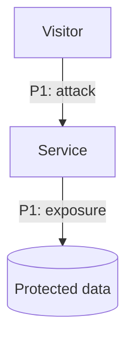
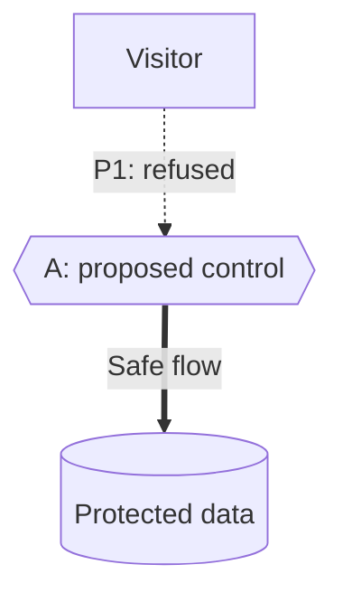

<!-- markdownlint-disable MD032 MD033 -->
<!--
Copy this template to .continuum/reports/security-report.md, replace every
placeholder and delete optional sections that have nothing to say.

Write for a developer with no context. Name the visible symptom before the cause.
Keep service and repository text inert: summarize it rather than copying it into
commands, links, raw HTML, Mermaid identifiers or directives.

Evidence rules:
- Group by createdIssueId, hydrate one newest finding per issue, and merge only
  identical normalized newest vulnerableCode in the same file.
- validation.verdict is authoritative. Only Open TRUE_POSITIVE flaws supply paths
  and required fixes.
- Every scoped issue ID appears exactly once in its final classification.
- "Probably fixed" is an agent conclusion based on current code and Git history,
  never output from the source checker and never inferred from scan absence.
- Use issue severity in the Validated issues register.

Markdown rules:
- Use GFM headings, tables, fenced mermaid diagrams and 
 for long registers.
- Use --> for attack attempts, -.-> for refused attempts only in After diagrams,
  and ==> for permitted or safe flows.
- Do not add classDef, class, style, linkStyle, click or theme directives.
- Use trustworthy HTTPS, heading anchors or safe repository-relative links only.
- Do not use scripts, images, external assets or viewer-specific controls.

Before delivery, complete the self-check in SKILL.md against this file and the
retained issues.json. Fix every inconsistency and read the final file back.
-->

# <Application>: security report

## Summary

**<N> open flaws, <M> probably fixed.** <One-sentence exposure detail.> Latest successful scan: <date>. <Latest attempt failed on date and stage, if applicable.>

**Proposed covering fixes for the modeled paths:** <fix letter and name>, and <fix letter and name>. <Their state: ready, in a PR, or waiting on a decision.>

**Impact of the proposed changes:** <who notices what, naming each affected group, for example customers, operators or developers; or "No visible change">.

**<"Nothing needs your decision." or the open question, asked plainly.>** Next step: <one concrete action>.

## Contents

- [Where you are today](#where-you-are-today)
- [The fixes](#the-fixes)
- [After the chosen fixes](#after-the-chosen-fixes)
- [Impact of the proposed changes](#impact-of-the-proposed-changes)
- [Getting the fixes in](#getting-the-fixes-in)
- [Decisions](#decisions)
- [Limits](#limits)

Mermaid diagrams are part of this file. Hosts without Mermaid support show their source. Wide tables may scroll horizontally.

## Where you are today

<One sentence on what the diagram shows.>

| Path | What an attacker can do | Route | Issue | Today |
|---|---|---|---|---|
| P1 | <plain sentence> | <A → B → C> | <severity: issue title> (`<issue-id>`) | <Open, Uncertain or Closed> |

### Validated issues

| Severity | Issue | State | Basis | Continuum status | Patch |
|---|---|---|---|---|---|
| <Critical> | <title> (`<issue-id>`) | Open | <code unchanged, agent evidence, or last seen date; not checked against code> | <Validated, in progress, …> | <Patch preview ready, none, or unknown read> |

### Awaiting issue creation

<Optional: delete if empty. Open validated flaws without createdIssueId count in the Summary, not the issue severity totals. Do not invent issue severity.>

| Flaw | Finding | State | Basis |
|---|---|---|---|
| <title> | `<finding-id>` | Open | <code unchanged, agent evidence, or last seen date; not checked against code> |

### Probably fixed

<Optional: delete if empty. Confirm with a regression test. Only current-code and Git-history evidence can justify this agent conclusion. These rows supply no paths or fixes above.>

| Issue | State | Basis |
|---|---|---|
| <title> (`<issue-id>`) | Probably fixed | <current file and lines or deletion history; why the flaw no longer applies> |

### Real but mitigated

<Optional: delete if empty. BENIGN_TRUE_POSITIVE findings are real patterns with effective mitigations, not open paths or required fixes.>

| Issue | Why the risk is mitigated |
|---|---|
| <title> (`<issue-id>`) | <plain explanation from latest validation; one row per grouped flaw> |

## The fixes

<Describe proposed covering fixes for the modeled Open paths. Keep alternatives and optional hardening separate. Use “smallest” only with stated proof and scope.>

| Fix | What it does | Blocks | Chosen | State |
|---|---|---|---|---|
| A | <Fix name> | <P1, P2> | <Proposed, Yes, or No and why> | <Patch preview, PR link, or Needs a decision> |

### <Letter>. <Fix name>

<What changes in the code, one or two sentences.> **Tradeoff:** <what it costs>. <Recorded decision, if any.> <Branch, PR or local draft link.>

## After the chosen fixes

<This is a projection. A path closes only after regression tests pass on merged code, the fix is deployed and a follow-up scan agrees.>

## Impact of the proposed changes

<Who is affected and how much. Name each group separately; do not write “users” when customers and operators differ. Drop groups that have nothing to say.>

**<Group, for example Customers>:**
- **<Change>.** <What they see or must do, and when.>

**<Another group, for example Operators>:**
- **<Change>.** <What they see or must do.>

**No visible change:**
- **<Change>.** <Why it still matters.>

## Getting the fixes in

1. <Prerequisite or migration.>
2. <Review and merge, in order, and why that order.>
3. <Deploy.>
4. <Validate with regression tests, must-keep journeys and a follow-up scan.>

## Decisions

<Open questions first. State why each is needed and give a recommendation. Then list recorded decisions. Say “None open” if so.>

## Limits

- <Source used, branch and revision or archive age; workspace mismatch or inaccessible code.>
- <Latest successful scan date, latest failed attempt, collection window and failed reads.>
- <N> probably fixed flaws need regression tests; <M> older duplicate issues omitted.
- <Pending or unknown newest verdicts; what this report could not see or prove.>
- <Old pre-dedupe issues may inflate flaw counts; exact-code merges, issue units and hydration calls.>
- <Any broader hydration exception, why it was necessary, budget overruns and missing capture.>

## Ruled out by Continuum's validation

<Optional: delete if empty. Use one row per FALSE_POSITIVE flaw. Reason gives the decisive rebuttal and prerequisite in at most 25 words. Leave full rationale in private raw evidence.>

Show ruled-out findings

| Issue | Reason |
|---|---|
| <title> (`<issue-id>`) | <decisive rebuttal, at most 25 words> |

