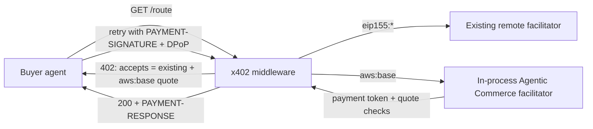

# AWS Marketplace Agentic Commerce Seller Onboarding

## Overview

Guides a seller from "my API has an AWS Marketplace Agentic Commerce listing" to "my x402 routes accept AWS Marketplace payments", in Python or TypeScript, without disturbing payment networks the seller already supports.

The AWS MCP server is recommended for running the AWS CLI steps in this skill, because it executes them in a sandbox and records them in an audit log. Every step also works with the AWS CLI alone.

## Guardrail — where this skill's own files live (MCP vs local install)

This skill can be loaded two ways, and they resolve the skill's own bundled
files from different places. Determine how the skill was loaded before reading
a reference or running a script:

- **Loaded through the AWS MCP `retrieve_skill` tool:** The skill is not
  installed on the local filesystem. You MUST fetch each reference or script
  via `retrieve_skill` with the `file` parameter (e.g.
  `file="references/architecture.md"` or `file="scripts/deploy.py"`), and
  run the script from the returned content. Do NOT `file_read` these paths
  locally — they do not exist on disk.
- **Installed locally** (e.g. `.kiro/skills/your-skill/` or
  `~/.claude/skills/your-skill/`): Read and run files from the local skill
  directory using relative paths.

This distinction applies only to the skill's own packaged files. User data and
session artifacts are always read from and written to the user's working
directory. Never fetch or write customer data through `retrieve_skill`.

## Usage

Use this skill when a seller:

- Wants an HTTP API to accept fiat payments from AI agents through AWS Marketplace over x402
- Already serves x402 payments on other networks (for example `eip155:8453`) and wants to add `aws:base`
- Is integrating `fiat-extension-for-x402` (PyPI) or `@aws/fiat-extension-for-x402` (npm)
- Needs to choose between an AWS KMS key and a self-managed key with a JWKS URL for quote signing
- Sees a `402` without an `aws:base` option, or payments refused with a reason from [references/troubleshooting.md](references/troubleshooting.md)

This skill does not create the Marketplace listing. The seller brings the product ID, endpoint URL and quote-signing key registered on an existing Agentic Commerce listing.

## Core Concepts

| Concept | What it means for the seller |
|---|---|
| `exact` scheme on `aws:base` | One more entry in each paid route's `accepts` list, priced in USD (`iso4217:USD`). Existing entries stay as they are. |
| Quote token | A JWT the seller signs into every `402` (`extra.quoteToken`). It carries the price, `payTo`, the scheme and network, and `settlement.product_id`. |
| `payTo` | The seller's **AWS Marketplace product ID** (`prod-…`), never a wallet address. On the wire it is replaced by `urn:x402:agentic-commerce:see-quote`; the signed quote holds the real value. |
| Service URL | The signer's `service_url` / `serviceUrl` becomes the quote's `iss` and **MUST** equal the endpoint URL registered on the listing. |
| Quote-signing key | The KMS key (alias ARN) or JWKS URL registered on the listing. The signer and the verifier **MUST** use that same key. |
| Payment token | Issued by AWS Marketplace after the buyer pays. The verifier checks it against the payment service's JWKS (built-in default) and against the quote it pays for. |
| Facilitator | Verification runs in the seller's own process: an x402 facilitator with the `exact` Agentic Commerce scheme. Settlement is a no-op that reports the payment ID (`awsmp-…`). |
| Coexistence | x402 core routes each payment to the facilitator client that advertises its network and scheme, so a remote facilitator keeps `eip155:*` while the in-process one takes `aws:base`. |



## Prerequisites

You **MUST** confirm the seller has these before writing code, since every value is signed into or checked against the listing:

- **Product ID** of the Agentic Commerce listing (`prod-…`)
- **Endpoint URL** registered on the listing, exactly as buyers call it (scheme, host, path prefix)
- **Quote-signing key** registered on the listing: a KMS alias ARN, or the JWKS URL the seller serves
- **Runtime:** a Python or Node.js version the SDK supports, and x402 major version 2. Check the package page on PyPI or npm for supported versions; the install in Step 2 resolves a compatible `x402` / `@x402/core`

Use the quote-signing key the seller provides. If the request does not name one, ask for it before writing signer code. This skill does not create keys: a seller with no key registered on the listing must create and register one first. [references/seller-keys.md](references/seller-keys.md) explains how to configure the signer and verifier for each key type.

## Onboarding Workflow

Copy this checklist into the conversation and tick items as you go:

- [ ] 1. Inputs collected (language, framework, product ID, endpoint URL, key type)
- [ ] 2. SDK installed next to the existing x402 packages
- [ ] 3. Quote signer and verifier configured with the listing's key
- [ ] 4. In-process facilitator added beside the existing facilitator client
- [ ] 5. aws:base option added to every paid route
- [ ] 6. Production settings applied (payment replay, DPoP store, HEAD, public URL, IAM)
- [ ] 7. 402 shows aws:base alongside the existing options

### Step 1: Collect inputs

Ask for the language and framework, then the prerequisites above. Read the seller's current x402 setup (resource server, facilitator client, registered schemes, route config) so the change is additive.

- **Does the seller already serve x402 on other networks?** Yes → follow the "next to an existing network" section of the language reference. No → follow its "aws:base only" section.
- **Python on Flask?** → use the `Sync` x402 objects and `"* /path"` route keys (see the Flask section of [references/python.md](references/python.md)).
- **TypeScript without Express, or on AWS Lambda?** → use `x402HTTPResourceServer` (see the "Other frameworks and AWS Lambda" section of [references/typescript.md](references/typescript.md)).

Then continue to Step 2.

### Step 2: Install

| Language | Command |
|---|---|
| Python | `pip install "fiat-extension-for-x402>=1.0.1" "x402[fastapi]"` (or `"x402[flask]"`) |
| TypeScript | `npm install @aws/fiat-extension-for-x402@^1.0.1 @x402/core` (plus `@x402/express express` for Express) |

Install the latest release. Version 1.0.1 is the minimum, because it is the first that signs and requires the scheme and network claims in quotes; earlier versions do not bind a quote to its scheme and network.

Keep the seller's existing x402 packages (for example `x402[evm]` or `@x402/evm`); you **MUST NOT** remove them, because existing networks still need them. Then continue to Step 3.

### Step 3: Configure the signer and verifier

| Listing key | Signer | Verifier seller key resolver |
|---|---|---|
| KMS alias ARN | `KmsQuoteSigner` | KMS (`KmsSellerKeyResolver` / `{ type: 'kms' }`) |
| JWKS URL | `LocalQuoteSigner.from_pem` / `fromPem`, plus a `/.well-known/jwks.json` route | JWKS (`JwksSellerKeyResolver` / `{ type: 'jwks' }`) |

Code is in the language reference: [references/python.md](references/python.md) or [references/typescript.md](references/typescript.md). Key creation, IAM and rotation are in [references/seller-keys.md](references/seller-keys.md). Then continue to Step 4.

### Step 4: Add the facilitator beside the existing one

Register the Agentic Commerce facilitator scheme on an x402 facilitator in the seller's process, and pass it to the resource server **in the same list** as the existing facilitator client. Register the Agentic Commerce server scheme on the same resource server that already has the seller's other schemes. You **MUST NOT** create a second resource server or middleware for `aws:base`, because one route can only be answered by one `402`. Then continue to Step 5.

### Step 5: Add aws:base to each paid route

Turn each paid route's `accepts` into a list (if it is a single option) and append:

```
scheme: "exact", network: "aws:base", payTo / pay_to: "<product ID>", price: "$0.01"
```

The price is the USD amount for that route (string `"$0.01"` / `"0.01 USD"`, a number, or `{amount, asset: "iso4217:USD"}`; at most 8 decimal places). Optional `extra` adds `description`, `reference` and `dimensions` to the quote. Then continue to Step 6.

### Step 6: Apply production settings

- **Accept each payment once:** verification is stateless, so a payment token is accepted on every request until it or its quote expires. If the seller asked for replay protection (or for the hook), add it directly. Otherwise you **MUST** tell the seller that their integration has no replay protection yet and offer to add it. To add it, use an x402 after-verify hook that records the verified payment token's `payment_id` claim and refuses one already recorded with `payment_replayed` (language reference, "Accept each payment once"). If the seller runs several instances, ask which shared store they use for the record (a per-instance in-memory store does not protect them). If the seller declines, or has no shared store behind several instances, state plainly in your summary that one payment can unlock repeated requests until the token expires.
- **DPoP replay store:** pass a `DPoPNonceStore` shared by every instance of the seller (`dpop_nonce_store` / `dpopNonceStore`). Without one, a captured proof can be replayed while it is fresh (60 seconds by default).
- **Public URL:** the request URL the framework sees **MUST** be the public URL buyers call, because DPoP proofs are bound to it. Behind a proxy or load balancer, forward the original `Host` and scheme.
- **HEAD:** Express and Flask answer `HEAD` with the `GET` handler, and x402 matches methods exactly, so an unpaid `HEAD` runs a paid handler. You **MUST** key those routes `"* /path"` or refuse `HEAD` (see the language reference).
- **IAM (KMS key):** the seller's role needs `kms:Sign` and `kms:GetPublicKey`, granted on the key ARN (`key/<id>`), not the alias ARN.
- **Secrets:** you **MUST** load a PEM key from a mounted file or secrets manager, never from source control, since anyone holding it can sign quotes for the product.
- **Throttling:** every unpaid request to a paid route signs a fresh quote (a KMS `Sign` call with a KMS key). Throttle paid routes, for example with API Gateway stage or usage-plan throttling or the framework's rate limiter, so unpaid traffic cannot run up signing cost or hit KMS request quotas.

Then continue to Step 7.

### Step 7: Confirm the 402

Send one unpaid request to a deployed paid route (no payment is made) and inspect the `402`. This needs `python3` (standard library only). Set the three values first:

```bash
ROUTE_URL=https://api.example.com/weather      # a paid route
PRODUCT_ID=prod-example123                    # the listing's product ID
ENDPOINT_URL=https://api.example.com          # the endpoint URL registered on the listing
python3 - "$ROUTE_URL" "$PRODUCT_ID" "$ENDPOINT_URL" <<'PY'
import base64, json, sys, urllib.error, urllib.request
url, product, iss = sys.argv[1:4]
def b64(s): return base64.urlsafe_b64decode(s + "=" * (-len(s) % 4))
try:
    urllib.request.urlopen(url, timeout=15); sys.exit("FAIL: expected 402, got 2xx/3xx")
except urllib.error.HTTPError as e:
    if e.code != 402: sys.exit(f"FAIL: expected 402, got {e.code}")
    header = e.headers.get("PAYMENT-REQUIRED")
if not header: sys.exit("FAIL: no PAYMENT-REQUIRED header (is x402 middleware on this route?)")
accepts = json.loads(b64(header)).get("accepts", [])
for o in accepts: print(f"- {o.get('scheme')} on {o.get('network')}: amount {o.get('amount')} asset {o.get('asset')}")
aws = [o for o in accepts if o.get("scheme") == "exact" and o.get("network") == "aws:base"]
if not aws: sys.exit("FAIL: no 'exact' option on 'aws:base'")
token = (aws[0].get("extra") or {}).get("quoteToken") or ""
if token.count(".") != 2: sys.exit("FAIL: aws:base option has no extra.quoteToken")
head, claims = (json.loads(b64(p)) for p in token.split(".")[:2])
print(f"quote kid={head.get('kid')} iss={claims.get('iss')} payTo={claims.get('payTo')} settlement={claims.get('settlement')}")
fails = [m for ok, m in [
    (claims.get("payTo") == product, "quote payTo is not the product ID"),
    ((claims.get("settlement") or {}).get("product_id") == product, "settlement.product_id is not the product ID"),
    (claims.get("iss") == iss, "quote iss is not the registered endpoint URL"),
    (str(aws[0].get("asset", "")).startswith("iso4217:"), "aws:base asset is not iso4217:<currency>"),
] if not ok]
for m in fails: print("FAIL:", m)
print("FAIL" if fails else "PASS"); sys.exit(1 if fails else 0)
PY
```

It lists every `accepts` entry and checks that one entry is `exact` on `aws:base` whose quote has `payTo` and `settlement.product_id` equal to the product ID and `iss` equal to the registered endpoint URL. Other entries (existing networks) are listed and left alone. Verify that it prints `PASS`. If it prints `FAIL`, fix the reported value, then run it again; see [references/troubleshooting.md](references/troubleshooting.md). Onboarding is complete when it prints `PASS`.

## Security Considerations

| Risk | Control in this skill |
|---|---|
| Quote-signing key compromise lets anyone sign quotes for the product | KMS key (private key never leaves KMS) or a PEM loaded from a secrets manager; IAM scoped to the one key ARN; JWKS rotation (seller-keys.md) |
| One payment unlocks many requests | Tell the seller they have no replay protection, and offer the after-verify hook with a store shared by all instances (Step 6) |
| Captured DPoP proof replayed | Shared `DPoPNonceStore` (Step 6) |
| Forwarded `Host` / scheme spoofed, or lost behind a proxy | Trust forwarding headers only from your own proxy or load balancer (for example Express `trust proxy` set to the hop count), and keep the public URL equal to the listing's endpoint URL |
| Unpaid `HEAD` runs a paid handler | `"* /path"` route keys or refuse `HEAD` (Step 6) |
| Signing cost and KMS quota exhaustion from unpaid traffic | Throttle paid routes (Step 6) |

For the general practices behind these controls, see the [AWS KMS best practices](https://docs.aws.amazon.com/kms/latest/developerguide/best-practices.html) and [Security best practices in IAM](https://docs.aws.amazon.com/IAM/latest/UserGuide/best-practices.html).

## Common Mistakes

| Mistake | Fix |
|---|---|
| `payTo` set to a wallet address or account ID | Use the Marketplace product ID |
| `service_url` / `serviceUrl` is a local or internal URL | Use the registered endpoint URL; it is the quote's `iss` |
| Verifier resolves a different key than the signer uses | Point both at the listing's key |
| Second middleware or resource server for `aws:base` | One resource server, one facilitator client list |
| Existing `accepts` replaced instead of extended | Append the `aws:base` option; keep the others |
| No after-verify hook, so one payment unlocks many requests | Record each `payment_id` and refuse repeats |
| Per-instance replay or DPoP store behind a load balancer | Use a store shared by all instances |

## Quick Reference

| | Python | TypeScript |
|---|---|---|
| Package | `fiat-extension-for-x402` | `@aws/fiat-extension-for-x402` |
| Register server scheme | `register_exact_agentic_commerce_server(server, signer=…)` | `registerExactAgenticCommerceServer(server, { signer })` |
| Facilitator | `register_exact_agentic_commerce_facilitator(x402Facilitator(), verifier=…)` | `new x402Facilitator().register('aws:base', new ExactAgenticCommerceFacilitatorScheme({ verifier }))` wrapped in `InProcessFacilitatorClient` |
| Replay hook | `server.on_after_verify(hook)` | `server.onAfterVerify(hook)` |
| Network | `aws:base` | `aws:base` |
| Failure reasons | [references/troubleshooting.md](references/troubleshooting.md) | same |
